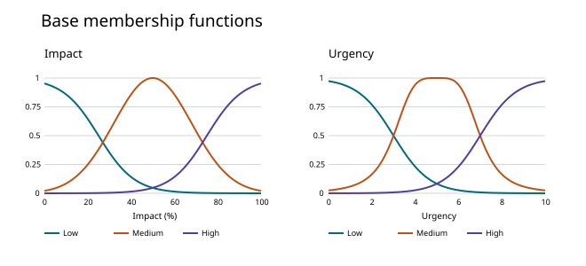
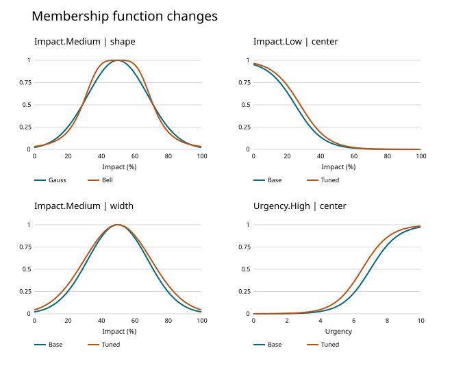

# ЛР №3. Приоритет инцидентов методом Сугено

В модели Сугено нулевого порядка каждое правило выдаёт постоянное числовое заключение. Входы модели — доля затронутых пользователей сервиса I (0–100%) и срочность U (0–10). Приоритет P измеряется по шкале от 0 до 100.

## Исходные данные

Численность пользователей и последствия — учебные допущения. Для каждого сервиса I = 100 × Nзатронутых / Nактивных. Срочность оценена отдельно по доступности обходного решения, срокам и последствиям простоя.

| ID | Инцидент | Затронуто / активно | I, % | U | Обоснование срочности |
|---|---|---:|---:|---:|---|
| INC-001 | Вёрстка информационного портала | 350/500 | 70 | 1 | Ссылки работают, доступна мобильная версия |
| INC-002 | Печать в подразделении | 16/160 | 10 | 3 | Можно перейти к принтеру на другом этаже |
| INC-003 | Задержка аналитических отчётов | 35/100 | 35 | 5 | Два отдела ждут дневную сводку, доступны вчерашние данные |
| INC-004 | Замедление CRM | 180/300 | 60 | 6 | Карточки открываются, время обслуживания клиентов выросло |
| INC-005 | Отказ удалённого VPN | 60/200 | 30 | 8 | У смены пропал доступ к рабочим системам, резервных подключений мало |
| INC-006 | Недоступность кадрового портала | 340/400 | 85 | 4 | Кадровики принимают заявки по почте |
| INC-007 | Отказ модуля ERP | 50/250 | 20 | 9 | Проводки отгрузок заблокированы перед закрытием смены |
| INC-008 | Задержка почты | 275/500 | 55 | 5 | Письма задерживаются на полчаса, для срочных согласований доступен чат |
| INC-009 | Ошибки аутентификации | 375/500 | 75 | 9 | Невозможен новый вход в ключевые системы, старые сеансы работают |
| INC-010 | Отказ сервиса приёма заказов | 400/400 | 100 | 10 | Обработка заказов остановлена, резервного канала нет |

## Базовая модель

Сигмоида имеет вид μ(x) = 1/(1 + exp(−a(x−c))), гауссова функция — exp(−(x−c)²/(2σ²)), обобщённый колокол — 1/(1 + |(x−c)/a|²ᵇ). В конфигурации параметры перечислены в следующем порядке.

| Вход | Low · sigmoid(a,c) | Medium | High · sigmoid(a,c) |
|---|---|---|---|
| Impact | (−0.12, 25) | gauss(c=50, σ=18) | (0.12, 75) |
| Urgency | (−1.2, 3) | bell(a=2, b=2, c=5) | (1.2, 7) |

| Impact ∖ Urgency | Low | Medium | High |
|---|---|---|---|
| Low | R1 · 0 | R2 · 25 | R5 · 57 |
| Medium | R3 · 30 | R4 · 50 | R6 · 82 |
| High | R5 · 57 | R6 · 82 | R7 · 100 |

Повторяющийся номер означает одно правило с двумя ветвями. В каждой ветви сначала вычисляется И, затем результаты объединяются через ИЛИ. Например, степень R5 равна S(T(I.Low,U.High), T(I.High,U.Low)). В базовой модели T = min и S = max.

Пусть αᵢ — степень активации, zᵢ — заключение. Тогда WA = Σ(αᵢzᵢ)/Σαᵢ и RMS = √(Σ(αᵢzᵢ²)/Σαᵢ). В протоколах для каждого активного правила приведены вклады в оба числителя. Программа сохраняет точность до формирования вывода, где округляет значения до трёх знаков. Оба рейтинга сортируются по неокруглённым значениям. При равенстве сохраняется исходный порядок.

## Результаты трёх экспериментов

Все столбцы получены на одних и тех же десяти строках. Каждый эксперимент изменяет только указанную часть базовой конфигурации.

| Инцидент | База WA / RMS | Произведение WA / RMS | Bell WA / RMS | Настройка WA / RMS |
|---|---:|---:|---:|---:|
| INC-001 | 43.414 / 46.306 | 41.863 / 44.356 | 43.178 / 46.069 | 42.512 / 45.450 |
| INC-002 | 17.241 / 24.047 | 15.351 / 21.549 | 16.786 / 23.577 | 19.545 / 26.655 |
| INC-003 | 43.779 / 47.595 | 44.901 / 47.437 | 44.199 / 47.762 | 45.101 / 49.069 |
| INC-004 | 59.935 / 63.154 | 58.949 / 61.181 | 59.337 / 62.440 | 61.199 / 64.494 |
| INC-005 | 62.707 / 65.813 | 66.453 / 68.730 | 62.989 / 66.078 | 63.288 / 66.182 |
| INC-006 | 68.395 / 70.971 | 72.461 / 74.080 | 69.854 / 72.168 | 66.314 / 69.359 |
| INC-007 | 60.875 / 62.544 | 62.050 / 63.544 | 59.783 / 61.370 | 61.980 / 63.633 |
| INC-008 | 52.777 / 55.539 | 52.447 / 54.143 | 52.708 / 55.406 | 53.336 / 56.458 |
| INC-009 | 89.201 / 90.318 | 90.733 / 91.437 | 89.523 / 90.673 | 88.562 / 89.650 |
| INC-010 | 98.447 / 98.761 | 99.146 / 99.226 | 98.160 / 98.525 | 97.950 / 98.332 |

**1. Пара логических операций.** В столбце «Произведение» используются T(a,b) = ab и S(a,b) = a + b − ab. Для INC-005 активация R2 (z = 25) падает с 0.165 до 0.058, а R6 (z = 82) — с 0.539 до 0.415. Поэтому после нормировки увеличивается относительный вес высокого заключения и WA растёт с 62.707 до 66.453. Для INC-001 WA, напротив, снижается. Меняется и порядок по RMS. В базе INC-004 стоит выше INC-007 (63.154 против 62.544), а после замены операций INC-007 опережает INC-004 (63.544 против 61.181).

**2. Форма функции.** Для Impact.Medium гауссова функция заменена колоколом с c = 50, b = 2 и a = 18√(2 ln 2) ≈ 21.193. Центры и ширины на половине высоты совпадают. При I = 85 степень Medium меняется с 0.151 до 0.119. У INC-006 ослабевают R3 (z = 30) и R4 (z = 50), тогда как R6 (z = 82) сохраняет активацию 0.769. Итоговый WA растёт с 68.395 до 69.854. Это изменение на 1.459 пункта оказалось самым большим по модулю в данном столбце WA.

**3. Чувствительность к параметрам.** Центр Impact.Low сдвинут с 25 до 28, ширина Impact.Medium увеличена с 18 до 20, центр Urgency.High сдвинут с 7 до 6.5. При том же I область высоких степеней Low и Medium расширяется, а высокая срочность начинает срабатывать раньше. Наибольший сдвиг WA наблюдается у INC-002 (с 17.241 до 19.545). INC-006 теряет 2.081 пункта WA. Оба порядка обработки при этой настройке сохранились для всех десяти инцидентов. Это вывод о данном наборе и выбранных изменениях. Чувствительность близких по баллам инцидентов видна по перестановке в эксперименте 1.

В базовом рейтинге у INC-010 наибольший приоритет по обоим методам (WA = 98.447 и RMS = 98.761). В этом инциденте слабо активны и правила с заключением ниже 100. Для всех строк RMS ≥ WA, поскольку значения zᵢ неотрицательны, а взвешенное среднее квадратов не меньше квадрата среднего.

## Протоколы и воспроизведение

[Базовая конфигурация](base.txt) · [Эксперимент 1](product.txt) · [Эксперимент 2](bell.txt) · [Эксперимент 3](tuned.txt)

Каждый протокол содержит исходные I и U, шесть степеней принадлежности, значения ветвей сложных правил, активации, заключения, вклады, суммы и два итоговых рейтинга. Команда `python lab3/experiments.py` из корня репозитория заново создаёт четыре протокола и печатает сравнительную таблицу. Для проверки собственных данных используйте `python lab3/sugeno.py --data путь_к_файлу.json`.
